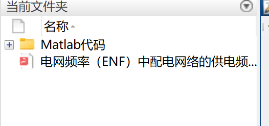
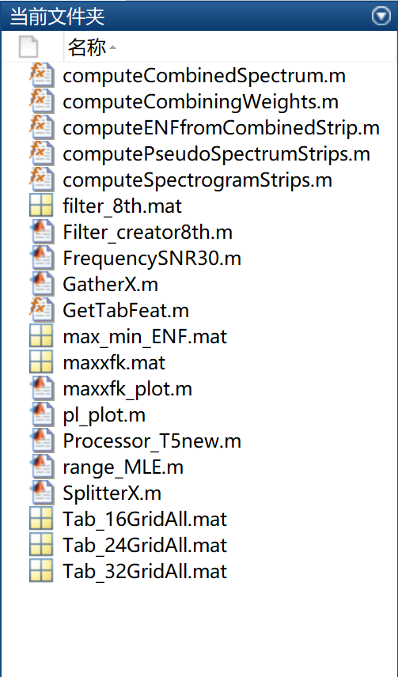

# Research on the Power Frequency (ENF) of Distributed Networks in Grid Frequency (Matlab Code Implementation)

Grid Frequency (ENF) is the study of power supply frequency in distribution networks (Matlab code implementation).

## Images

<!-- PAYMENT_BLOCK -->

## Get this dataset

- Payment link (Stripe): [Buy now](https://buy.stripe.com/3cs8yP7sY87d0vu9AB)
- Payment QR code: 

<!-- /PAYMENT_BLOCK -->
